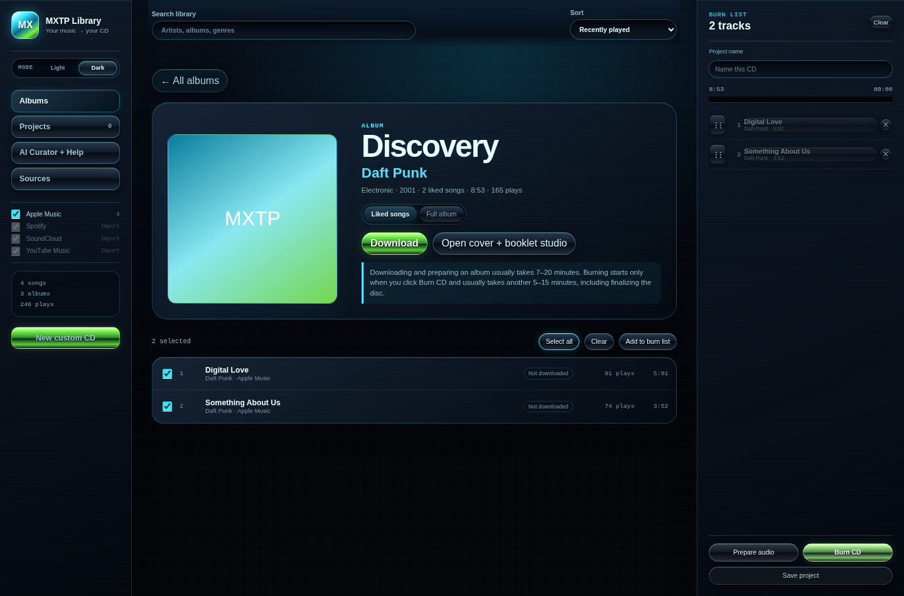

# MXTP MKR

A desktop app for building a custom audio CD end to end: pick the tracks, lay out print-ready jewel-case inserts and booklets, and burn the disc.

## What it is

Making a mixtape CD that looks like a real release means juggling a music library, a print shop's template sizes, booklet page math and a disc burner. MXTP MKR puts those steps in one Tauri app. It is a personal-use prototype built for one person's library and drives, not a polished product.



## Features

- **Library browser.** Reads a local Apple Music library database directly (decrypts the `hfma` file and parses it), and imports Spotify, SoundCloud and YouTube Music data exports.
- **Burn list with a capacity meter.** Tracks fill a queue measured against the 80-minute Red Book limit, with drag and keyboard reordering.
- **Print-accurate inserts.** Front insert, tray card, disc face and saddle-stitch booklets from 4 to 28 pages, sized from Disc Makers template measurements and exported as PDFs with media, bleed and trim boxes.
- **Booklet layout.** Paginates track lists and lyrics into safe areas, imposes pages onto printer spreads, and previews the folded booklet in 3D.
- **3D case preview.** An interactive jewel case (react-three-fiber) that shows the assigned artwork on each surface.
- **Real CD burning.** Builds a CD-DA image with CD-Text (album, artist and track titles) and writes it through IMAPI2 on Windows or `cdrskin` on Linux, with a simulate mode.
- **Album research and cover art.** Looks up track lists on MusicBrainz, fetches lyrics, and generates or edits cover art through a selectable image backend.

## Tech stack

- **Languages:** TypeScript, Rust, Python (Linux playlist fetcher), PowerShell (Windows playlist fetcher)
- **Desktop:** Tauri 2
- **UI:** React 18, Vite, three.js with @react-three/fiber, pdf-lib
- **Backend:** reqwest, lopdf, rusqlite, image, aes + flate2, the `windows` crate (IMAPI2)
- **External tools:** ffmpeg and ffprobe, yt-dlp, cdrskin (Linux burning)
- **Tests:** Vitest with Testing Library, Rust integration tests, Playwright for live checks

## Getting started

### Prerequisites

- Node.js 20 or newer and pnpm
- Rust (stable) and the [Tauri 2 system prerequisites](https://v2.tauri.app/start/prerequisites/) for your OS
- On Linux: `ffmpeg`, `yt-dlp` and `cdrskin` on your `PATH` (only needed for audio prep, downloads and burning)
- On Windows: place `ffmpeg.exe`, `ffprobe.exe`, their `-x86_64-pc-windows-msvc.exe` copies, `yt-dlp-x86_64-pc-windows-msvc.exe` and `node-x86_64-pc-windows-msvc.exe` in `src-tauri/binaries/` before building. These third-party binaries are not committed.

### Install

```bash
git clone https://github.com/Phoenixn82/mxtp-mkr.git
cd mxtp-mkr
pnpm install
```

### Configure

The app reads its settings from environment variables; `.env.example` lists them. Export the ones you need in the shell that runs `pnpm tauri dev` (for example `set -a; . ./.env; set +a` after copying it to `.env`). The default cover-art backend, Pollinations, needs no key. Cloudflare Workers AI needs an account ID and API token.

### Run

```bash
pnpm tauri dev        # desktop app with hot reload
pnpm test             # Vitest suite
cd src-tauri && cargo test   # Rust integration tests (some hit MusicBrainz and lyrics sites)
pnpm tauri build      # .deb and AppImage on Linux, NSIS and MSI on Windows
```

## How it works

The React front end holds the project state: the burn list, the art assigned to each print slot and the booklet pages. Print sizes come from `src/print/dimensions.generated.ts`, which `scripts/gen-dimensions.mjs` builds from a CSV of measurements pulled out of the Disc Makers templates, so no component hardcodes a bleed or trim number. The booklet code paginates text into each page's safe area, `impose()` maps reader pages onto printer spreads, and pdf-lib or the Rust `pdf_compose` module writes the PDFs.

For a burn, the front end calls Tauri commands in Rust. `audio_prep` uses ffmpeg to convert each track to 44.1 kHz, 16-bit stereo PCM, `burn` lays the tracks out in sectors (lead-in, 2-second pregaps, lead-out), encodes CD-Text packs with their CRCs, and hands the image to IMAPI2 or to `cdrskin` with a generated cue sheet. Album lookups go to MusicBrainz and are cached on disk, and YouTube album matching scores candidate playlists with a small weighted model in `src-tauri/resources/album-match-model.json`.

## Known limits

- The Linux burn path has tests but no recorded burn on real hardware yet.
- The `codex` image backend does not work with current codex-cli releases and fails with an explicit error.
- Only download and burn audio you have the rights to.

## License

MIT. See [LICENSE](LICENSE).
